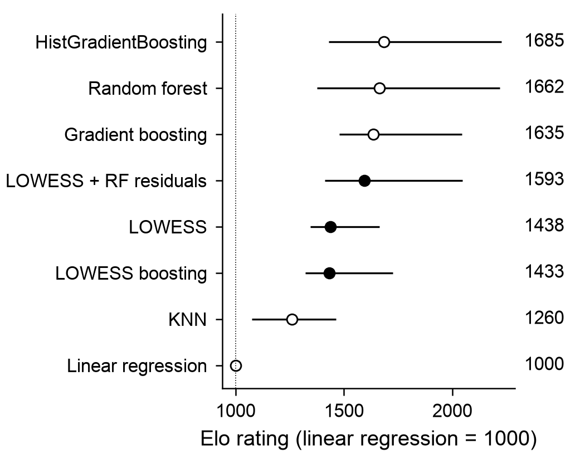
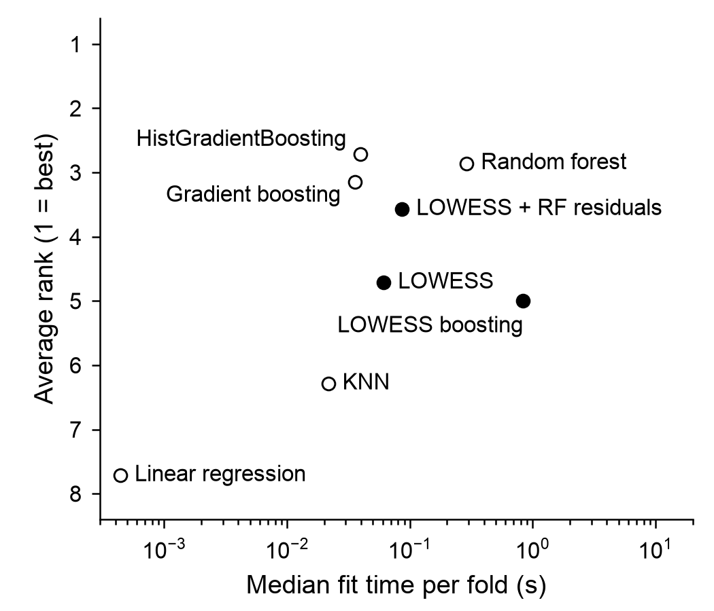
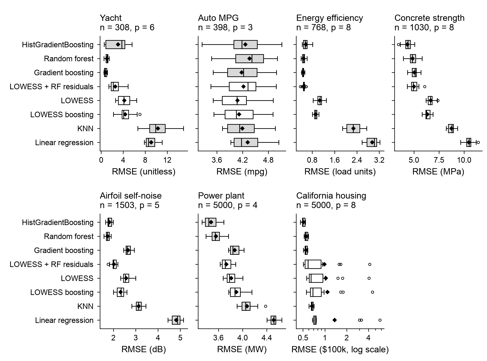

# lowess-boosting

LOWESS (locally weighted linear regression) for any number of features, and
least-squares gradient boosting with LOWESS as the base learner, both as scikit-learn estimators.



**Figure 1.** *Elo ratings of eight regressors on seven public regression datasets.* Ratings come
from pairwise comparisons of test RMSE (root mean squared error) over 5-fold
cross-validation repeated 3 times, with linear regression fixed at 1000, and bars are 95% bootstrap intervals over datasets
([method](#evaluation-method)). Filled circles are the LOWESS (locally weighted scatterplot smoothing) family and open circles
are baselines (RF is random forest, KNN is k-nearest neighbors).

## Results in brief

- The course-project hybrid (LOWESS plus a random forest on its residuals) ranks
  4th of 8 by average rank (3.57) and has an Elo rating of 1593, against 1685 for
  HistGradientBoosting, the top model.
- Plain LOWESS has the lowest mean error only on Auto MPG (4.08 mpg), where all
  eight models are within 0.24 mpg and no difference is significant. On yacht,
  energy, concrete, airfoil and power plant it is significantly worse than the best
  model (Holm-adjusted p < 0.001); on California the outlier folds leave the
  test inconclusive. Its Elo rating is 1438.
- Boosted LOWESS fits in a median 0.8 s per fold, against 0.04 s for
  HistGradientBoosting, and costs about 12 to 16 times plain LOWESS on the four
  largest datasets. A full-data California run did not finish in 45 minutes, so
  California and power plant are 5,000-row samples.
- Seven datasets limit the statistics. No Wilcoxon comparison with the top model
  survives Holm adjustment (smallest adjusted p 0.109), and the Elo intervals
  overlap widely.

## What this project shows

- The method is implemented from the maths: weighted normal equations with
  Cleveland's robustifying iterations. In one dimension it matches statsmodels'
  `lowess` to within 1e-10
  ([tests/test_statsmodels_agreement.py](tests/test_statsmodels_agreement.py)).
- Both estimators pass the full `parametrize_with_checks` suite on five
  configurations with no expected failures
  ([tests/test_sklearn_compat.py](tests/test_sklearn_compat.py)).
- 368 tests pass at 100% branch coverage. CI runs ruff, mypy and pytest on Ubuntu
  with Python 3.10 to 3.14, plus Windows and macOS
  ([.github/workflows/ci.yml](.github/workflows/ci.yml)).
- The benchmark uses repeated K-fold with Nadeau-Bengio corrected intervals,
  Holm-adjusted Wilcoxon tests and Bradley-Terry Elo ratings as in TabArena. The
  statistics are unit-tested against hand calculations
  ([benchmarks/bench_stats.py](benchmarks/bench_stats.py),
  [tests/test_benchmark_stats.py](tests/test_benchmark_stats.py)).
- [HISTORY.md](HISTORY.md) lists eight problems in the original DATA 441
  notebooks and how each was fixed, such as a kernel that went negative and a
  ridge term that penalised the intercept.
- Results are reported as measured, including that LOWESS loses to tree
  ensembles on six of the seven datasets.

## Install

```bash
pip install git+https://github.com/Siyuan-Zhu/lowess-boosting-from-scratch
```

Python 3.10 or newer. To run the tests or benchmarks from a clone:
`pip install -e ".[dev,bench]"`. Agents and contributors: see
[AGENTS.md](AGENTS.md) and [CONTRIBUTING.md](CONTRIBUTING.md).

## Usage

```python
import numpy as np
from sklearn.model_selection import cross_val_score
from sklearn.pipeline import make_pipeline
from sklearn.preprocessing import StandardScaler
from lowess_boosting import LowessBoostingRegressor, LowessRegressor

rng = np.random.default_rng(0)
X = rng.uniform(-3, 3, size=(500, 2))
y = np.sin(X[:, 0]) * X[:, 1] + rng.normal(scale=0.2, size=500)
boosted = LowessBoostingRegressor(LowessRegressor(frac=0.3), n_estimators=5)
model = make_pipeline(StandardScaler(), boosted)
print(cross_val_score(model, X, y, cv=5).mean().round(3))  # 0.93
```

At `frac=0.3` a single LOWESS fit scores 0.869 on this data, and five boosting
stages recover most of the lost detail. A single LOWESS with `frac=0.1` scores
0.954, so tune the span before adding stages.

## API

### `LowessRegressor(frac=1/3, bandwidth=None, kernel="tricubic", robust_iters=0, ridge=1e-3)`

Each prediction is the intercept of a weighted least-squares line fitted
around the query point.

| Parameter | Meaning |
|---|---|
| `frac` | Share of the training set in each neighbourhood. The bandwidth at a query is the distance to its `ceil(frac * n)`-th nearest training point. |
| `bandwidth` | Fixed kernel width in feature units. Overrides `frac` when set. |
| `kernel` | `"tricubic"`, `"epanechnikov"`, `"quartic"` or `"gaussian"`, applied to `u = distance / bandwidth`. In `frac` mode the gaussian is cut off at the neighbourhood edge where it still weighs 0.61, so its fits can jump as points enter or leave the window. |
| `robust_iters` | Cleveland's bisquare robustifying iterations. Points with residuals above six median absolute residuals get zero weight. |
| `ridge` | Relative L2 penalty on the local slopes: ridge regression on locally standardised features, so results do not depend on the units of `X`. The intercept is never penalised. |

Fitted attributes: `X_fit_`, `y_fit_`, `n_neighbors_`, `robustness_weights_`,
`n_features_in_`.

Distances are Euclidean on the raw inputs, so put a `StandardScaler` in front
when features have different units.

### `LowessBoostingRegressor(estimator=None, n_estimators=5, learning_rate=0.5, subsample=1.0, residual_estimator=None, random_state=None)`

Starts from the mean of `y`, then adds `n_estimators` clones of `estimator`
(default `LowessRegressor()`), each fitted to the current residuals and scaled
by `learning_rate`. `subsample < 1` fits each stage on a random subset of rows.
`residual_estimator`, if given, is fitted once to what is left at the end.

`staged_predict(X)` yields the prediction after each stage. `train_score_`
holds the in-sample MSE after each stage.

The base learner can be any scikit-learn regressor. Pass it explicitly
(`LowessBoostingRegressor(LowessRegressor())`) if you want to tune its
parameters as `estimator__frac` in a grid search.

## Design notes

### Numerical core

All the numerical work sits in one private function,
`_local.local_linear_predict`. For a block of query points it computes the
distances with `scipy.spatial.distance.cdist`, finds each query's k-th
neighbour distance with `np.partition`, applies the kernel and then builds
every query's weighted normal equations with two matrix products against
per-sample outer products `z_i z_i^T`. It then profiles out the intercept,
standardises each feature by its local weighted spread and solves for the
slopes with a batched eigendecomposition. Blocks are capped at about 2 million
query-by-training entries, so memory stays bounded for large test sets.

### Degenerate neighbourhoods

A neighbourhood with fewer than `n_features + 1` distinct points cannot
identify every slope. Eigenvalues of the standardised system below a relative
cutoff are dropped, so slopes in directions the neighbourhood does not span
are set to zero at any `ridge`, including 0, and in any units. When all
weighted points sit at one location the prediction is their weighted mean. If a query has no positively weighted training point at
all (a narrow fixed bandwidth, or robustness weights that zero a whole
neighbourhood), it gets the mean target of the nearest training points that
still have positive weight.

### Robustifying iterations

These follow Cleveland (1979) and the structure of Alexandre Gramfort's
univariate gist: fit at every training point, compute
bisquare weights from the residuals, and multiply them into the kernel weights
for the next pass and for prediction. The median absolute residual has a small
floor relative to `max|y|`, so an exact fit does not turn round-off into
outliers.

### Origin

The package started as three DATA 441 course projects.
[HISTORY.md](https://github.com/Siyuan-Zhu/lowess-boosting-from-scratch/blob/main/HISTORY.md)
lists what changed from those notebooks and why.

### scikit-learn checks

The test suite runs the full `parametrize_with_checks` suite on five
configurations: default LOWESS, LOWESS with robust iterations, LOWESS with a
fixed gaussian bandwidth, default boosting, and boosting with subsampling and
a residual estimator. Every check passes and none is marked as an expected
failure. scikit-learn skips its array-API input check unless
`SCIPY_ARRAY_API=1` is set; with the variable set, that check passes too.

In one dimension, `LowessRegressor(frac=k/n, robust_iters=K, ridge=0)`
matches statsmodels' `lowess(frac=f, it=K, delta=0)` at the training points
to within 1e-10, where `k = floor(f * n)` (`tests/test_statsmodels_agreement.py`,
run with the `statsmodels` extra installed).

## Benchmarks

Everything below comes from one run on 2026-10-23. It took 700 s (about 12 minutes) on an Apple
arm64 laptop (single-threaded BLAS). Rebuild it with:

```bash
pip install -e ".[bench]"
OMP_NUM_THREADS=1 OPENBLAS_NUM_THREADS=1 VECLIB_MAXIMUM_THREADS=1 \
    python benchmarks/run_benchmarks.py   # fits the models, writes results.json
python benchmarks/report.py               # tables and figures from results.json
```

Versions: Python 3.13.15, numpy 2.5.4, scipy 1.18.1, scikit-learn 1.9.1,
matplotlib 3.11.2, lowess-boosting 0.1.0. Datasets are downloaded at run time
(OpenML through scikit-learn, and the UCI zip for the power plant data) and are
not stored here. Only the four figure files in `benchmarks/results/` are
committed; `results.json` has every fold's RMSE, MAE, R², fit time and predict
time and is regenerated by the run.

### Evaluation method

The leaderboard follows [TabArena](https://tabarena.ai) (NeurIPS 2025 Datasets
and Benchmarks track; [arXiv:2506.16791](https://arxiv.org/abs/2506.16791)),
which rates tabular models by Elo from pairwise comparisons that weight every
dataset equally, and plots rating against training time. I fit a Bradley-Terry
model by maximum likelihood and convert it to the Elo scale. I did not
replicate TabArena's full pipeline. Post-hoc tests on mean ranks, such as the
Nemenyi test behind critical-difference diagrams, can change their verdict when
other models join or leave the pool (Benavoli, Corani and Mangili, [JMLR
17, 2016](https://jmlr.org/papers/v17/benavoli16a.html)). The comparisons against
the top model therefore use pairwise Wilcoxon signed-rank tests with Holm
adjustment, as they recommend.

### Datasets

| Dataset | Source | Rows used | Features | Target (RMSE unit) |
|---|---|---|---|---|
| Yacht hydrodynamics | OpenML 42370 (UCI 243) | 308 | 6 | residuary resistance (dimensionless) |
| Auto MPG | OpenML 196 | 398 | 3 (cylinders, displacement, weight) | mpg |
| Energy efficiency | OpenML 43918 (UCI 242) | 768 | 8 | heating load Y1 (load units) |
| Concrete strength | OpenML 4353 (UCI 165) | 1,030 | 8 | compressive strength (MPa) |
| Airfoil self-noise | OpenML 43919 (UCI 291) | 1,503 | 5 | sound pressure (dB) |
| Power plant output | UCI 294 | 5,000 of 9,568 | 4 | net electrical output (MW) |
| California housing | scikit-learn | 5,000 of 20,640 | 8 | median house value ($100k) |

The two 5,000-row sets are seeded random samples (seed 0). The tuned boosting
model refits LOWESS at every training row in every stage, so a full-data run on
California was too slow: it had not finished one model after 45 minutes. The
power plant data was cut to the same size for the same reason. Auto MPG uses the
three predictors from the course project.

### Protocol

- Repeated K-fold, 5 folds x 3 repeats (15 test folds), seed 0. All models see
  the same folds, so fold scores are paired across models.
- Every model sits behind a `StandardScaler`. LOWESS `frac` (0.02, 0.05, 0.1,
  0.2, 0.4) and KNN `n_neighbors` (5, 10, 20, 40) are picked per outer fold by a
  3-fold inner grid search on the training part. Everything else is fixed: the
  boosting model uses 5 stages at learning rate 0.5, and the "LOWESS + RF
  residuals" row is LOWESS at `frac=1/6` followed by a 100-tree, depth-7 random
  forest on its residuals (the original course setup).
- Per fold: RMSE, MAE, R², fit time and predict time. The fit time of tuned models includes
  the inner grid search (16 fits for LOWESS, 13 for KNN).
- Intervals: 95% Nadeau-Bengio corrected CI on the mean RMSE, t distribution
  with 14 degrees of freedom, test/train ratio 1/4.
- Paired test against the best model on each dataset (lowest mean RMSE): the
  same correction applied to the 15 paired fold differences, then Holm
  adjustment across the 7 comparisons on that dataset.
- Across datasets: Bradley-Terry Elo ratings with a bootstrap interval over
  datasets, average ranks with Friedman's test, and Holm-adjusted Wilcoxon
  signed-rank tests against the top-rated model. A model wins a comparison when
  its RMSE is lower, averaged over the 5 folds of one repeat, and a tie counts as
  half a win. The fit adds half a win to each side of every pair, which keeps
  ratings finite when a model never wins. Elo is 400/ln(10) times the
  Bradley-Terry log-strength, shifted so that linear regression is 1000.

<details>
<summary>Tables, Figure 2 and notes on reading them</summary>

### Results by dataset

**Table 1.** Mean RMSE ± half-width of the 95% corrected CI (in each
dataset's own units). Bold is the lowest mean on that dataset.

| Model | Yacht | Auto MPG | Energy | Concrete | Airfoil | Power plant | California | Average rank |
|---|---|---|---|---|---|---|---|---|
| HistGradientBoosting | 3.050 ± 2.203 | 4.26 ± 0.62 | 0.571 ± 0.134 | **4.36 ± 0.59** | 1.82 ± 0.13 | **3.48 ± 0.14** | **0.506 ± 0.032** | 2.71 |
| Random forest | 1.022 ± 0.330 | 4.36 ± 0.55 | 0.492 ± 0.074 | 4.88 ± 0.64 | **1.74 ± 0.12** | 3.56 ± 0.12 | 0.554 ± 0.033 | 2.86 |
| Gradient boosting | **0.788 ± 0.293** | 4.18 ± 0.51 | **0.472 ± 0.044** | 5.07 ± 0.44 | 2.66 ± 0.18 | 3.87 ± 0.11 | 0.549 ± 0.031 | 3.14 |
| LOWESS + RF residuals | 2.549 ± 1.266 | 4.22 ± 0.51 | 0.496 ± 0.062 | 5.01 ± 0.56 | 2.03 ± 0.15 | 3.73 ± 0.11 | 0.992 ± 1.145 | 3.57 |
| LOWESS | 4.206 ± 1.651 | **4.08 ± 0.49** | 1.070 ± 0.142 | 6.67 ± 0.44 | 2.58 ± 0.23 | 3.81 ± 0.13 | 1.036 ± 1.101 | 4.71 |
| LOWESS boosting | 4.363 ± 1.598 | 4.12 ± 0.50 | 0.924 ± 0.074 | 6.36 ± 0.42 | 2.32 ± 0.23 | 3.90 ± 0.14 | 1.088 ± 1.233 | 5.00 |
| KNN | 10.339 ± 2.828 | 4.19 ± 0.48 | 2.277 ± 0.314 | 8.75 ± 0.47 | 3.14 ± 0.21 | 4.07 ± 0.15 | 0.666 ± 0.036 | 6.29 |
| Linear regression | 9.077 ± 1.353 | 4.32 ± 0.47 | 2.945 ± 0.248 | 10.48 ± 0.57 | 4.82 ± 0.27 | 4.51 ± 0.08 | 1.369 ± 1.778 | 7.71 |

LOWESS has the lowest mean on Auto MPG only, and there every model's
interval overlaps every other. On the other six datasets it ranks 4th to 6th.
On California a few folds inflate the means of the LOWESS family and linear
regression, and the CI is as wide as the mean. Table A1 gives medians and worst
folds, and Figure A1 plots every fold.

The California numbers keep their outlier folds. One block group in the test
data has an average occupancy of 1,243 against a training maximum of 41. A
local linear fit extends its slope out to that point and predicts about 129 for
a true value of 1.4, roughly 90 times too large. Each of the three LOWESS models
and linear regression has one fold with RMSE above 4 (4.07 to 5.76). Their
median fold RMSE is 0.59 to 0.73, against 0.50 for HistGradientBoosting. KNN and
the tree models average training targets, so an extreme input cannot push them
outside the training range.

### Results across datasets

**Table 2.** Rank of each model on each dataset (1 = lowest mean RMSE) and the
average rank. Friedman chi-square = 26.14 (df 7, p<0.001); Iman-Davenport F = 6.86 (p<0.001); 7 datasets, 8 models.

| Model | Yacht | Auto MPG | Energy | Concrete | Airfoil | Power plant | California | Average rank |
|---|---|---|---|---|---|---|---|---|
| HistGradientBoosting | 4 | 6 | 4 | 1 | 2 | 1 | 1 | 2.71 |
| Random forest | 2 | 8 | 2 | 2 | 1 | 2 | 3 | 2.86 |
| Gradient boosting | 1 | 3 | 1 | 4 | 6 | 5 | 2 | 3.14 |
| LOWESS + RF residuals | 3 | 5 | 3 | 3 | 3 | 3 | 5 | 3.57 |
| LOWESS | 5 | 1 | 6 | 6 | 5 | 4 | 6 | 4.71 |
| LOWESS boosting | 6 | 2 | 5 | 5 | 4 | 6 | 7 | 5.00 |
| KNN | 8 | 4 | 7 | 7 | 7 | 7 | 4 | 6.29 |
| Linear regression | 7 | 7 | 8 | 8 | 8 | 8 | 8 | 7.71 |

Figure 1, at the top of this page, turns these comparisons into Elo ratings.

**Table 3.** Elo rating of each model (linear regression anchored at 1000) with a
95% percentile bootstrap interval over the 7 datasets (1,000 resamples).

| Model | Elo | 95% CI |
|---|---|---|
| HistGradientBoosting | 1685 | [1430, 2227] |
| Random forest | 1662 | [1376, 2219] |
| Gradient boosting | 1635 | [1478, 2043] |
| LOWESS + RF residuals | 1593 | [1411, 2048] |
| LOWESS | 1438 | [1346, 1662] |
| LOWESS boosting | 1433 | [1323, 1725] |
| KNN | 1260 | [1075, 1464] |
| Linear regression | 1000 | [1000, 1000] |

**Table 4.** Wilcoxon signed-rank tests of each model against the top-rated model,
HistGradientBoosting, on the 7 datasets' log RMSE ratios (two-sided), with
Holm-adjusted p-values across the 7 comparisons.

| Model | Datasets where it beats the top model | W | p | p (Holm) |
|---|---|---|---|---|
| Random forest | 3 of 7 | 12 | 0.812 | 1.000 |
| Gradient boosting | 3 of 7 | 13 | 0.938 | 1.000 |
| LOWESS + RF residuals | 3 of 7 | 12 | 0.812 | 1.000 |
| LOWESS | 1 of 7 | 1 | 0.031 | 0.188 |
| LOWESS boosting | 1 of 7 | 1 | 0.031 | 0.188 |
| KNN | 1 of 7 | 1 | 0.031 | 0.188 |
| Linear regression | 0 of 7 | 0 | 0.016 | 0.109 |

With 7 datasets the smallest two-sided p-value the exact test can return is
2/128 = 0.016, and Holm adjustment over 7 comparisons raises that to 0.109, so
no pairwise result in Table 4 can pass 0.05. The win counts carry the
information: LOWESS, LOWESS boosting and KNN beat HistGradientBoosting on 1 of 7
datasets, and linear regression on none.

Figure 2 plots the Elo ratings against the median fit time per fold.



**Figure 2.** *Elo rating against median fit time of eight regressors.* Ratings are
those in Figure 1. Fit time is the median over the seven datasets of each
dataset's median per-fold fit time, in seconds on a log axis, and includes the
inner grid search of the tuned models. The thin step line is the Pareto front,
the models that no other model beats on both rating and fit time. Filled circles
are the LOWESS family and open circles are baselines. The ratings carry the wide
intervals shown in Figure 1. No LOWESS variant is on the front.

HistGradientBoosting and gradient boosting fit in about 0.04 s per fold and
rate 1685 and 1635. Plain LOWESS needs 0.06 s and rates 1438. Boosted LOWESS needs 0.8 s without a higher rating (1433), while
random forest rates 1662 at 0.29 s.

### Paired comparison with the best model

**Table 5.** Mean RMSE difference to the best model on that dataset (model minus
best, same units as Table 1; positive means worse), with the Holm-adjusted
p-value in brackets. The best model on each dataset is marked "best".

| Model | Yacht | Auto MPG | Energy | Concrete | Airfoil | Power plant | California |
|---|---|---|---|---|---|---|---|
| HistGradientBoosting | +2.262 (p=0.055) | +0.18 (p=0.839) | +0.099 (p=0.286) | best | +0.07 (p=0.049) | best | best |
| Random forest | +0.234 (p=0.055) | +0.28 (p=0.653) | +0.019 (p=0.729) | +0.51 (p<0.001) | best | +0.08 (p=0.010) | +0.049 (p<0.001) |
| Gradient boosting | best | +0.10 (p=0.893) | best | +0.70 (p<0.001) | +0.92 (p<0.001) | +0.39 (p<0.001) | +0.044 (p<0.001) |
| LOWESS + RF residuals | +1.760 (p=0.019) | +0.14 (p=0.772) | +0.024 (p=0.729) | +0.65 (p=0.003) | +0.28 (p<0.001) | +0.25 (p<0.001) | +0.486 (p=1.000) |
| LOWESS | +3.418 (p<0.001) | best | +0.598 (p<0.001) | +2.30 (p<0.001) | +0.83 (p<0.001) | +0.33 (p<0.001) | +0.530 (p=1.000) |
| LOWESS boosting | +3.575 (p<0.001) | +0.04 (p=0.893) | +0.452 (p<0.001) | +1.99 (p<0.001) | +0.58 (p<0.001) | +0.42 (p<0.001) | +0.582 (p=1.000) |
| KNN | +9.550 (p<0.001) | +0.11 (p=0.885) | +1.805 (p<0.001) | +4.38 (p<0.001) | +1.39 (p<0.001) | +0.60 (p<0.001) | +0.161 (p<0.001) |
| Linear regression | +8.289 (p<0.001) | +0.23 (p=0.508) | +2.473 (p<0.001) | +6.12 (p<0.001) | +3.08 (p<0.001) | +1.03 (p<0.001) | +0.864 (p=1.000) |

### Reading the results

- Five boosting stages help on energy (1.07 to 0.92), concrete (6.67 to 6.36) and
  airfoil (2.58 to 2.32), and do nothing or hurt on yacht, Auto MPG, power plant
  and California.
- On concrete the hybrid reaches 5.01 against 4.88 for a random forest alone, so
  the forest does most of the work.
- The Friedman test rejects "all models are equal" (chi-square 26.14,
  p < 0.001). The pairwise tests are weaker, as Table 4 shows.
- Four of the seven datasets have fewer than 1,100 rows, which is also why the
  yacht intervals are wide. The corrected intervals are about 2.2 times wider than
  naive ones (the `(1/15 + 1/4)` against `1/15` variance term) and still treat the
  15 fold scores as exchangeable, which holds only approximately.

</details>

## Limitations

- LOWESS stores the training set, and predicting costs
  `O(n_queries * n_train * n_features^2)`. With `robust_iters=0`, fitting
  only validates and stores the data. Robustifying iterations and every
  boosting stage refit at all training points, which costs `O(n_train^2)`.
- Each `predict` call builds an `n_train x (n_features + 1)^2` array. With
  20,000 training rows, peak memory measured with `tracemalloc` was about
  140 MB for 8 features and 540 MB for 50.
- Neighbourhoods are Euclidean balls with no feature weighting, so every
  feature counts equally in the distance and irrelevant features dilute the
  neighbourhood. As the number of features grows, a fixed share of the data
  covers a wider region and the fit gets less local. Scale the inputs, and
  drop features that do not matter.
- No `sample_weight`, sparse input, missing values (NaN is rejected),
  multi-output targets or classification.
- Local linear fits extrapolate linearly. A query far outside the training
  data gets its neighbourhood's slope extended out to it, which is how one
  extreme California row produced a prediction about 90 times too large (see
  [Benchmarks](#benchmarks)). Clip or transform heavy-tailed features first.
- `LowessBoostingRegressor` supports squared error only and has no early
  stopping. Use `staged_predict` on a validation set to pick `n_estimators`.

## Development

```bash
pip install -e ".[dev]"
ruff check . && ruff format --check . && mypy
pytest --cov
```

CI runs ruff, mypy and pytest on Ubuntu with Python 3.10 to 3.14, and on Windows
and macOS with 3.13, then builds the wheel and imports it from a clean virtual
environment.

## Acknowledgements

This package started as coursework for DATA 441 (Advanced Applied Machine
Learning) at William & Mary. The robustifying iterations follow the structure
of Alexandre Gramfort's
[univariate LOWESS gist](https://gist.github.com/agramfort/850437) (BSD
3-clause). See [NOTICE](https://github.com/Siyuan-Zhu/lowess-boosting-from-scratch/blob/main/NOTICE) for the license text.

References:

- W. S. Cleveland (1979). Robust locally weighted regression and smoothing
  scatterplots. *JASA* 74(368), 829-836.
- W. S. Cleveland and S. J. Devlin (1988). Locally weighted regression: an
  approach to regression analysis by local fitting. *JASA* 83(403), 596-610.
- J. H. Friedman (2001). Greedy function approximation: a gradient boosting
  machine. *Annals of Statistics* 29(5), 1189-1232.

## License

MIT. See [LICENSE](https://github.com/Siyuan-Zhu/lowess-boosting-from-scratch/blob/main/LICENSE).

## Appendix: per-dataset results

<details>
<summary>Figure A1 and the per-dataset tables</summary>

Figure A1 shows every fold's RMSE on each dataset.



**Figure A1.** *Per-fold test RMSE of eight regressors on seven datasets.* Each
box shows the RMSE of one model over 15 test folds: 5-fold cross-validation
repeated 3 times with seed 0, on the same folds for every model. LOWESS `frac`
and the neighbor count of k-nearest neighbors (KNN) are tuned by 3-fold
cross-validation inside each training set. The vertical line is the median, the
box spans the interquartile range, whiskers reach the furthest fold within 1.5
times that range, circles are folds beyond the whiskers, and the diamond is the
mean. White boxes are the LOWESS family and gray boxes are baselines (RF is
random forest). Each x-axis has its own scale and units. California housing uses
a log axis so that all folds show.

On most datasets the boxes of the LOWESS family sit to the right of the tree
ensembles, and on Auto MPG every box overlaps. On California the three LOWESS
models and linear regression each have a fold above 4, far from their medians.

**Table A1.** Median / worst-fold RMSE.

| Model | Yacht | Auto MPG | Energy | Concrete | Airfoil | Power plant | California |
|---|---|---|---|---|---|---|---|
| HistGradientBoosting | 3.734 / 5.596 | 4.19 / 5.11 | 0.548 / 0.817 | 4.40 / 5.08 | 1.78 / 2.00 | 3.44 / 3.69 | 0.499 / 0.541 |
| Random forest | 1.065 / 1.476 | 4.42 / 5.01 | 0.491 / 0.617 | 4.84 / 5.81 | 1.73 / 1.90 | 3.55 / 3.77 | 0.548 / 0.596 |
| Gradient boosting | 0.761 / 1.139 | 4.22 / 4.99 | 0.466 / 0.535 | 5.12 / 5.71 | 2.62 / 2.94 | 3.84 / 4.02 | 0.545 / 0.583 |
| LOWESS + RF residuals | 2.187 / 4.861 | 4.32 / 4.98 | 0.501 / 0.584 | 4.93 / 6.08 | 2.01 / 2.20 | 3.71 / 3.88 | 0.587 / 4.148 |
| LOWESS | 4.107 / 6.426 | 4.07 / 4.91 | 1.079 / 1.303 | 6.65 / 7.39 | 2.53 / 3.00 | 3.78 / 4.00 | 0.645 / 4.070 |
| LOWESS boosting | 4.082 / 7.040 | 4.05 / 4.91 | 0.924 / 1.039 | 6.26 / 6.91 | 2.35 / 2.61 | 3.87 / 4.15 | 0.682 / 4.524 |
| KNN | 9.900 / 14.977 | 4.13 / 4.96 | 2.266 / 2.753 | 8.80 / 9.35 | 3.12 / 3.46 | 4.05 / 4.38 | 0.664 / 0.712 |
| Linear regression | 8.596 / 11.058 | 4.18 / 5.04 | 3.022 / 3.225 | 10.51 / 11.41 | 4.87 / 5.15 | 4.52 / 4.65 | 0.729 / 5.762 |

**Table A2.** Paired tests against the best model on each dataset: mean
difference, corrected 95% CI, t, raw p and Holm-adjusted p.

**Yacht hydrodynamics** (n=308, p=6, best: Gradient boosting, test/train ratio 0.250)

| Model | Mean diff | 95% corrected CI | t | p | p (Holm) |
|---|---|---|---|---|---|
| HistGradientBoosting | +2.262 | [+0.288, +4.237] | 2.46 | 0.028 | 0.055 |
| Random forest | +0.234 | [-0.002, +0.470] | 2.12 | 0.052 | 0.055 |
| LOWESS + RF residuals | +1.760 | [+0.580, +2.941] | 3.20 | 0.006 | 0.019 |
| LOWESS | +3.418 | [+1.921, +4.914] | 4.90 | <0.001 | <0.001 |
| LOWESS boosting | +3.575 | [+2.106, +5.043] | 5.22 | <0.001 | <0.001 |
| KNN | +9.550 | [+6.910, +12.191] | 7.76 | <0.001 | <0.001 |
| Linear regression | +8.289 | [+7.108, +9.471] | 15.05 | <0.001 | <0.001 |

**Auto MPG** (n=398, p=3, best: LOWESS, test/train ratio 0.250)

| Model | Mean diff | 95% corrected CI | t | p | p (Holm) |
|---|---|---|---|---|---|
| HistGradientBoosting | +0.18 | [-0.11, +0.47] | 1.31 | 0.210 | 0.839 |
| Random forest | +0.28 | [-0.07, +0.63] | 1.71 | 0.109 | 0.653 |
| Gradient boosting | +0.10 | [-0.17, +0.36] | 0.78 | 0.446 | 0.893 |
| LOWESS + RF residuals | +0.14 | [-0.06, +0.34] | 1.51 | 0.154 | 0.772 |
| LOWESS boosting | +0.04 | [-0.08, +0.15] | 0.65 | 0.524 | 0.893 |
| KNN | +0.11 | [-0.11, +0.33] | 1.09 | 0.295 | 0.885 |
| Linear regression | +0.23 | [-0.02, +0.49] | 1.94 | 0.073 | 0.508 |

**Energy efficiency (heating)** (n=768, p=8, best: Gradient boosting, test/train ratio 0.250)

| Model | Mean diff | 95% corrected CI | t | p | p (Holm) |
|---|---|---|---|---|---|
| HistGradientBoosting | +0.099 | [-0.020, +0.218] | 1.79 | 0.095 | 0.286 |
| Random forest | +0.019 | [-0.029, +0.068] | 0.86 | 0.403 | 0.729 |
| LOWESS + RF residuals | +0.024 | [-0.031, +0.078] | 0.94 | 0.364 | 0.729 |
| LOWESS | +0.598 | [+0.433, +0.763] | 7.78 | <0.001 | <0.001 |
| LOWESS boosting | +0.452 | [+0.369, +0.535] | 11.70 | <0.001 | <0.001 |
| KNN | +1.805 | [+1.506, +2.104] | 12.95 | <0.001 | <0.001 |
| Linear regression | +2.473 | [+2.248, +2.699] | 23.51 | <0.001 | <0.001 |

**Concrete strength** (n=1030, p=8, best: HistGradientBoosting, test/train ratio 0.250)

| Model | Mean diff | 95% corrected CI | t | p | p (Holm) |
|---|---|---|---|---|---|
| Random forest | +0.51 | [+0.29, +0.74] | 4.96 | <0.001 | <0.001 |
| Gradient boosting | +0.70 | [+0.43, +0.97] | 5.53 | <0.001 | <0.001 |
| LOWESS + RF residuals | +0.65 | [+0.25, +1.04] | 3.51 | 0.003 | 0.003 |
| LOWESS | +2.30 | [+1.85, +2.75] | 10.96 | <0.001 | <0.001 |
| LOWESS boosting | +1.99 | [+1.53, +2.45] | 9.34 | <0.001 | <0.001 |
| KNN | +4.38 | [+3.80, +4.97] | 15.99 | <0.001 | <0.001 |
| Linear regression | +6.12 | [+5.40, +6.84] | 18.23 | <0.001 | <0.001 |

**Airfoil self-noise** (n=1503, p=5, best: Random forest, test/train ratio 0.250)

| Model | Mean diff | 95% corrected CI | t | p | p (Holm) |
|---|---|---|---|---|---|
| HistGradientBoosting | +0.07 | [+0.00, +0.15] | 2.16 | 0.049 | 0.049 |
| Gradient boosting | +0.92 | [+0.75, +1.08] | 11.98 | <0.001 | <0.001 |
| LOWESS + RF residuals | +0.28 | [+0.16, +0.41] | 4.79 | <0.001 | <0.001 |
| LOWESS | +0.83 | [+0.64, +1.03] | 9.31 | <0.001 | <0.001 |
| LOWESS boosting | +0.58 | [+0.35, +0.80] | 5.51 | <0.001 | <0.001 |
| KNN | +1.39 | [+1.18, +1.60] | 14.28 | <0.001 | <0.001 |
| Linear regression | +3.08 | [+2.81, +3.35] | 24.41 | <0.001 | <0.001 |

**Power plant output (5000-row sample)** (n=5000, p=4, best: HistGradientBoosting, test/train ratio 0.250)

| Model | Mean diff | 95% corrected CI | t | p | p (Holm) |
|---|---|---|---|---|---|
| Random forest | +0.08 | [+0.02, +0.14] | 2.97 | 0.010 | 0.010 |
| Gradient boosting | +0.39 | [+0.32, +0.46] | 12.01 | <0.001 | <0.001 |
| LOWESS + RF residuals | +0.25 | [+0.19, +0.32] | 8.18 | <0.001 | <0.001 |
| LOWESS | +0.33 | [+0.23, +0.44] | 6.75 | <0.001 | <0.001 |
| LOWESS boosting | +0.42 | [+0.32, +0.52] | 8.76 | <0.001 | <0.001 |
| KNN | +0.60 | [+0.47, +0.72] | 10.13 | <0.001 | <0.001 |
| Linear regression | +1.03 | [+0.93, +1.14] | 21.06 | <0.001 | <0.001 |

**California housing (5000-row sample)** (n=5000, p=8, best: HistGradientBoosting, test/train ratio 0.250)

| Model | Mean diff | 95% corrected CI | t | p | p (Holm) |
|---|---|---|---|---|---|
| Random forest | +0.049 | [+0.039, +0.059] | 10.49 | <0.001 | <0.001 |
| Gradient boosting | +0.044 | [+0.035, +0.053] | 10.16 | <0.001 | <0.001 |
| LOWESS + RF residuals | +0.486 | [-0.644, +1.617] | 0.92 | 0.372 | 1.000 |
| LOWESS | +0.530 | [-0.557, +1.617] | 1.05 | 0.313 | 1.000 |
| LOWESS boosting | +0.582 | [-0.638, +1.803] | 1.02 | 0.323 | 1.000 |
| KNN | +0.161 | [+0.121, +0.201] | 8.67 | <0.001 | <0.001 |
| Linear regression | +0.864 | [-0.900, +2.627] | 1.05 | 0.311 | 1.000 |

**Table A3.** Mean MAE (same units as RMSE).

| Model | Yacht | Auto MPG | Energy | Concrete | Airfoil | Power plant | California |
|---|---|---|---|---|---|---|---|
| HistGradientBoosting | 1.398 | 3.02 | 0.376 | 2.96 | 1.29 | 2.59 | 0.340 |
| Random forest | 0.500 | 3.08 | 0.333 | 3.38 | 1.25 | 2.62 | 0.376 |
| Gradient boosting | 0.415 | 2.99 | 0.337 | 3.74 | 2.01 | 2.98 | 0.383 |
| LOWESS + RF residuals | 1.509 | 2.94 | 0.362 | 3.47 | 1.50 | 2.84 | 0.396 |
| LOWESS | 2.485 | 3.01 | 0.766 | 4.99 | 1.86 | 2.87 | 0.438 |
| LOWESS boosting | 2.791 | 3.01 | 0.721 | 4.66 | 1.65 | 2.99 | 0.442 |
| KNN | 6.060 | 3.09 | 1.476 | 6.78 | 2.34 | 3.06 | 0.473 |
| Linear regression | 7.354 | 3.30 | 2.092 | 8.31 | 3.75 | 3.61 | 0.551 |

**Table A4.** Mean R².

| Model | Yacht | Auto MPG | Energy | Concrete | Airfoil | Power plant | California |
|---|---|---|---|---|---|---|---|
| HistGradientBoosting | 0.952 | 0.698 | 0.997 | 0.930 | 0.930 | 0.958 | 0.805 |
| Random forest | 0.995 | 0.683 | 0.998 | 0.913 | 0.936 | 0.956 | 0.766 |
| Gradient boosting | 0.997 | 0.709 | 0.998 | 0.907 | 0.850 | 0.948 | 0.770 |
| LOWESS + RF residuals | 0.969 | 0.703 | 0.998 | 0.908 | 0.913 | 0.951 | -0.360 |
| LOWESS | 0.920 | 0.723 | 0.989 | 0.838 | 0.859 | 0.949 | -0.381 |
| LOWESS boosting | 0.912 | 0.718 | 0.991 | 0.853 | 0.885 | 0.947 | -0.612 |
| KNN | 0.523 | 0.708 | 0.948 | 0.722 | 0.792 | 0.942 | 0.661 |
| Linear regression | 0.623 | 0.691 | 0.914 | 0.602 | 0.508 | 0.929 | -1.896 |

**Table A5.** Mean fit time / predict time per fold, in seconds. Fit time
includes the inner grid search of the tuned models.

| Model | Yacht | Auto MPG | Energy | Concrete | Airfoil | Power plant | California |
|---|---|---|---|---|---|---|---|
| HistGradientBoosting | 0.0124 / 0.000434 | 0.0152 / 0.000536 | 0.0288 / 0.000753 | 0.0457 / 0.0014 | 0.0396 / 0.00158 | 0.0513 / 0.00379 | 0.0658 / 0.00432 |
| Random forest | 0.11 / 0.00607 | 0.101 / 0.00655 | 0.146 / 0.00815 | 0.363 / 0.0106 | 0.3 / 0.0125 | 1.4 / 0.0393 | 2.62 / 0.0385 |
| Gradient boosting | 0.0152 / 0.000191 | 0.0157 / 0.000207 | 0.0226 / 0.000257 | 0.0565 / 0.000349 | 0.0356 / 0.000332 | 0.256 / 0.00109 | 0.41 / 0.00101 |
| LOWESS + RF residuals | 0.0351 / 0.00251 | 0.0333 / 0.00252 | 0.0499 / 0.00449 | 0.104 / 0.00623 | 0.0872 / 0.0082 | 0.585 / 0.0732 | 0.864 / 0.0828 |
| LOWESS | 0.0164 / 0.000431 | 0.0172 / 0.000653 | 0.0405 / 0.00198 | 0.0615 / 0.00369 | 0.0955 / 0.00517 | 0.938 / 0.0594 | 1.05 / 0.073 |
| LOWESS boosting | 0.111 / 0.00222 | 0.114 / 0.00259 | 0.481 / 0.0095 | 0.836 / 0.0185 | 1.27 / 0.0239 | 15 / 0.299 | 17.2 / 0.371 |
| KNN | 0.0118 / 0.000303 | 0.0119 / 0.000321 | 0.0162 / 0.000419 | 0.0217 / 0.000605 | 0.0245 / 0.000609 | 0.062 / 0.00214 | 0.155 / 0.0102 |
| Linear regression | 0.000377 / 8.75e-05 | 0.00164 / 8.87e-05 | 0.000444 / 9.25e-05 | 0.000473 / 0.000115 | 0.00047 / 9.43e-05 | 0.000694 / 0.000109 | 0.000797 / 0.000112 |

</details>
